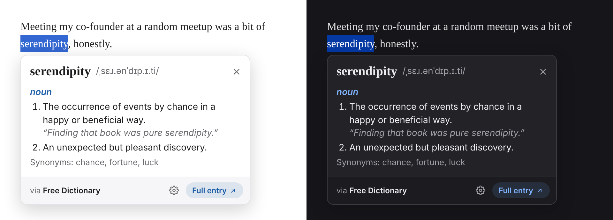

# Define Word

A lightweight Firefox extension that shows a word's definition in a popup right where you're reading. Select a word, then right-click → **Define** or press **Alt+Shift+D**.



## Features

- **Inline popup** right below the selected word, in light or dark mode to match your system
- **Merriam-Webster** definitions and pronunciation audio once you add a free API key; the [Free Dictionary API](https://dictionaryapi.dev) is used when no key is set
- **Word forms explained**: looking up *wiping* shows *"wiping" is a form of* **wipe**
- **Suggestions** for misspelled words
- Closes on **Esc**, a click outside it, or when the mouse leaves it

## Install

1. Clone this repository.
2. Open `about:debugging#/runtime/this-firefox` and click **Load Temporary Add-on…**
3. Select `manifest.json`.

Temporary add-ons are removed when Firefox restarts. To install it permanently, sign it for free as an unlisted add-on:

```sh
npx web-ext sign --channel=unlisted --api-key=<AMO_KEY> --api-secret=<AMO_SECRET>
```

Then drag the generated `.xpi` into Firefox.

## Merriam-Webster key (optional)

1. Register at [dictionaryapi.com](https://dictionaryapi.com/register/index) and request a **Collegiate Dictionary** key.
2. Open the extension settings: the ⚙ button in the popup, or `about:addons` → Define Word → Preferences.
3. Paste the key and click **Validate & save**. The key is checked against Merriam-Webster before it's stored.

## Privacy & security

- No content scripts run until you trigger a lookup, so the extension can't read the pages you visit.
- The API key is stored only on your device and isn't synced. It's sent only to `dictionaryapi.com` over HTTPS and is never exposed to web pages.
- The popup renders inside a closed Shadow DOM and inserts dictionary data as plain text only.
- Network access is restricted by CSP to the dictionary APIs and Merriam-Webster's audio host.

## Project structure

| File | Purpose |
| --- | --- |
| `manifest.json` | Extension manifest (MV3) |
| `background.js` | Context menu, shortcut, lookups, audio download |
| `common.js` | API clients and response normalization |
| `content.js` | The popup UI |
| `options.html` / `options.js` | Settings page for the API key |

## License

[MIT](LICENSE)
